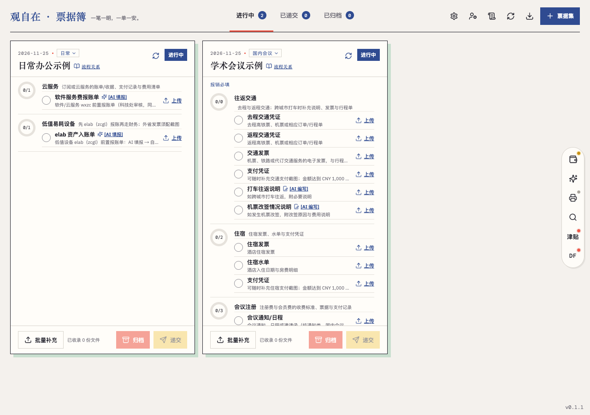
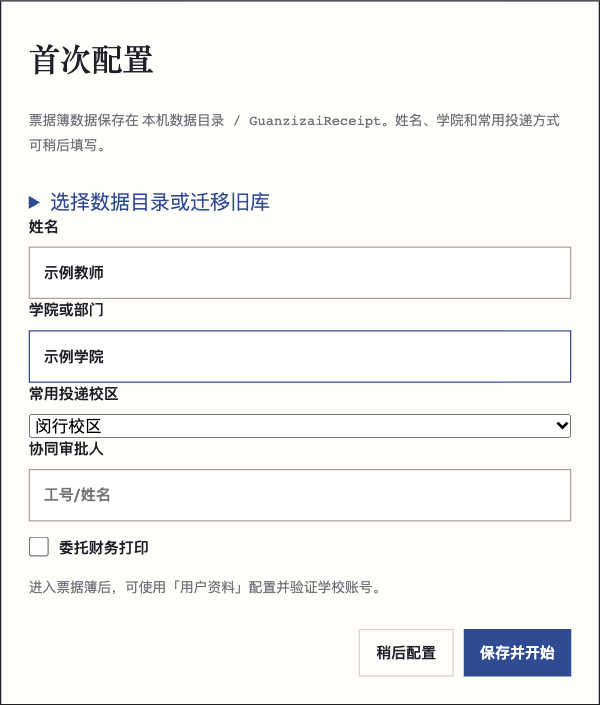

# 观自在 · 票据簿

**面向高校教师的本地报销材料管理工具**，帮助你把差旅、会议和日常开销整理成可递交、可跟踪的票据集。项目面向华东师范大学教师，同时提供可供其他用户和开发者使用的本地票据管理功能。

[下载最新版本](https://github.com/morningD/Guanzizai-Receipt/releases/latest) · [教师使用指南](docs/TEACHER_GUIDE.md) · [版本说明](docs/RELEASE_NOTES.md) · [报告问题](https://github.com/morningD/Guanzizai-Receipt/issues)



*截图使用虚构票据集，界面会随版本调整。*

## 票据簿能做什么

围绕一次事项创建票据集，依次整理材料、准备递交、跟踪财务状态并归档。首页按「进行中」「已递交」「已归档」展示各阶段，票据集可按需要拆分或从归档还原。

### 票据集与材料

- 为国际会议、国内会议、国内差旅或日常开销创建票据集，按类型展示相应的材料清单和流程关系。
- 批量导入发票、收据、支付记录、行程单等文件，查看材料完成情况、缺件和金额。一次支出的多份凭证可关联展示，避免合计重复计算。
- 关联发票与支付凭证、行程材料等证据。匹配综合使用金额、币种、日期及业务信息，云服务材料可按付款月份区分。
- 通过右侧「文件搜索」跨进行中、已递交和已归档查找材料，支持关键词高亮、悬浮预览、打开预览和下载。

### AI 辅助

- 配置识别后端后，可辅助识别和分类导入文件，提取票据信息，回答票据集相关问题，生成交通或改签说明草稿。
- 搜索历史费用清单并按需引用，可使用 AI 辅助排序。云服务清单、发票和支付记录可在同一事项下查看。
- 支持 OpenAI 兼容 API、Codex CLI 和 OpenCode CLI，也可关闭 AI。图片识别需要支持视觉输入的模型。调用外部模型时，所选材料或相关内容会发送给所配置的服务商。

### 递交、财务状态与归档

- 在递交清单中检查材料、金额、经费和投递信息，按需打印、下载材料或拆分递交。
- 华师大用户可使用校内财务集成准备线上报销草稿，并在确认后提交。具体可用操作取决于本人账号权限和学校系统状态。
- 已登记报销单的票据集可刷新财务状态，在报销详情中查看经费项目、入账信息和时间线。关联单据入账后，可单笔归档或一键归档。

### 华师大业务工具

- **经费与预算**：连接校内财务系统，查询本人有权访问的项目预算及执行情况，并为票据集选择经费项目。
- **前置报账**：根据材料准备 elab 材料易耗品低值品报账或软件服务费报账，查看相关单据状态。
- **学生津贴与党费**：维护学生津贴信息与发放数据；党费模块支持工资数据抓取、逐月计算和手工调整，可按需停用。
- **规则库**：查看费用分类、材料规则、流程和配对流程，并维护汇率缓存。具体报销要求以学校及所在学院的实际规定为准。

### 本地数据与设置

- 在系统设置中管理数据目录、备份和恢复。票据原件和用户资料保存在所选本机数据目录。
- 首页右下角版本号提供版本说明和更新入口。兼容的程序更新在原目录准备，重新启动后应用。
- 遇到问题时可在系统设置中预览并下载脱敏诊断 JSON，检查内容后自行选择是否附在反馈中。

## 下载与首次使用

| 平台 | 发布包 | 启动方式 |
| --- | --- | --- |
| Windows x64 | `Guanzizai-Receipt-v版本号-windows-x64.zip` | 解压后双击 `Start-Receipt-Desk.cmd` |
| macOS Apple 芯片 | `Guanzizai-Receipt-v版本号-macos-arm64.zip` | 解压后双击 `Start-Receipt-Desk.command` |

1. 从 [Releases](https://github.com/morningD/Guanzizai-Receipt/releases/latest) 下载完整 ZIP，解压到可写目录并运行启动脚本。首次启动后在浏览器中打开票据簿。
2. 在首次配置中选择数据目录，填写姓名、学院或部门、投递校区等信息，也可以先跳过，之后在设置中补充。
3. 使用华师大集成时，配置本人的学校账号并按浏览器提示登录。校内功能需要 Chrome 或 Microsoft Edge，完整发布包已包含所需运行环境。
4. 如需 AI 识别，在右侧「AI 后端设置」选择后端和模型。API 直连需要自行提供服务地址和密钥，CLI 方式需要预先安装并配置对应工具。
5. 新建票据集并导入材料，核对识别结果和递交清单后继续办理。



更详细的迁移、打印、备份、恢复和更新步骤见[教师使用指南](docs/TEACHER_GUIDE.md)。当前完整包覆盖 Windows x64 和 Apple 芯片 macOS。不同学院权限、真实校内业务和实体打印机仍需要更多实际环境反馈。

## 数据、网络与隐私

票据簿作为本机服务运行，票据和应用数据保存在用户选择的数据目录。华师大集成会访问学校系统，在线汇率会访问汇率服务，AI 功能会按所选后端发送请求。学校账号和 API 密钥由用户自行配置，API 密钥使用本机系统加密存储。

备份包含票据和用户资料。提交 Issue、PR 或分享截图、诊断文件前，请检查并清理姓名、工号、经费信息、登录凭据及票据内容。

## 从源码开发

需要 Node.js 24；发布流水线使用 Node.js 24.22.3。克隆仓库后运行：

```bash
git clone https://github.com/morningD/Guanzizai-Receipt.git
cd Guanzizai-Receipt
npm ci
npm run dev:local
```

在浏览器打开 `http://127.0.0.1:8030/`。源码开发环境使用本机 Node.js。使用校内集成还需要 Python 和 [学校功能依赖](tools/requirements-school.txt)，以及 Chrome 或 Edge。服务默认使用系统 Python，也可通过 `RECEIPT_PYTHON_BIN` 指定安装了依赖的 Python 可执行文件。

提交前可执行以下检查：

```bash
npm run check
npm test
npm run build:portable-preview
```

`npm test` 运行公开仓库中的测试。公开 CI 在 Linux、Windows 和 macOS 上运行类型检查、测试和构建。公开测试使用示例数据，涉及历史真实材料的测试留在授权环境。

### 代码目录

| 路径 | 内容 |
| --- | --- |
| `src/` | React 界面、票据模型、分类与配对规则 |
| `server/` | 本机服务、材料与设置接口、更新和诊断 |
| `tools/`、`treasury_research/` | 华师大系统集成和财务状态工具 |
| `scripts/portable/` | 启动、数据目录和更新相关脚本 |
| `docs/` | 教师使用指南、版本说明和界面截图 |

欢迎通过 [Issues](https://github.com/morningD/Guanzizai-Receipt/issues) 讨论问题或建议，通过 Pull Request 贡献修复、文档和学院适配。反馈时请提供版本、操作系统、复现步骤、预期结果和实际结果。

## 许可证

项目采用 [木兰宽松许可证，第 2 版](LICENSE)（Mulan PSL v2）。第三方依赖适用各自的许可证。
