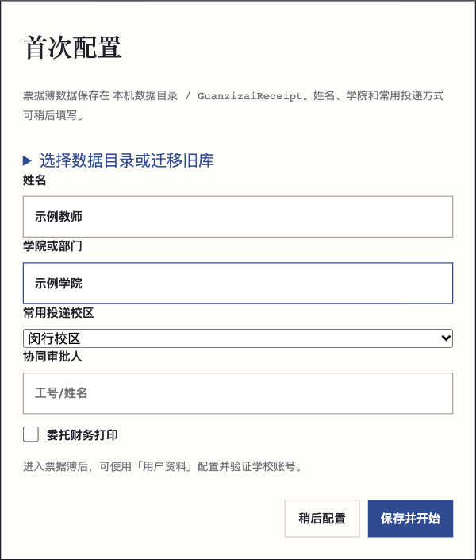
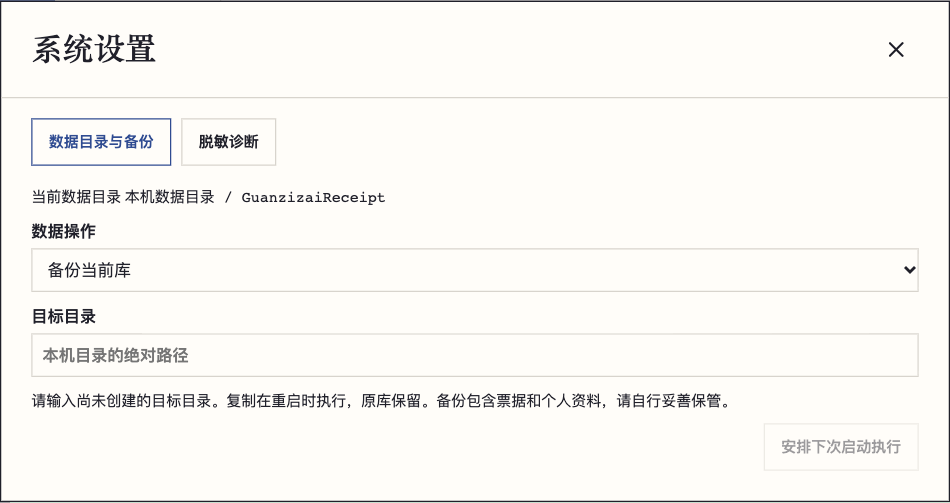

# 观自在 · 票据簿使用指南

票据簿用于整理报销材料、准备递交和跟踪入账。票据和用户资料保存在本机。华东师大集成使用您自己的学校账号和权限。

## 下载与启动

1. 从发布页下载对应的完整 ZIP。Windows 选择 x64 版，Apple 芯片的 Mac 选择 macOS 版。
2. 将 ZIP 完整解压到本机可写目录。Windows 双击 `Start-Receipt-Desk.cmd`，macOS 双击 `Start-Receipt-Desk.command`。
3. 等待浏览器打开票据簿。使用期间保留启动窗口。完成后回到启动窗口按 Ctrl+C 关闭服务。

完整 ZIP 已带运行程序和 Python。使用校内功能时，请先安装 Chrome 或 Microsoft Edge。macOS 如提示无法确认来源，请先核对下载地址及发布页的 SHA-256，再按系统提示继续。

## 首次配置

- 核对数据目录。已有票据簿用户可展开「选择数据目录或迁移旧库」。迁移请填写旧库根目录和一个尚未创建的新目录。
- 填写姓名、学院或部门、常用投递校区及协同审批人。也可以点击「稍后配置」。
- 在页头「用户信息配置」中维护本人资料和学校账号。学院、经费和审批人以本单位实际要求为准。
- 第一次登录校内系统时，按浏览器提示完成身份验证。先测试本人可读取的预算或财务状态，再办理实际递交。

## 整理一组票据

1. 点击「新建票据集」，为同一次出差、会议或日常报销建立一组。
2. 在票据卡片里批量补充发票、支付记录和其他所需材料。归类后核对金额、币种和材料配对。云服务可按付款月份查找发票与支付记录。
3. 从右侧工具栏打开「文件搜索」，可在进行中、已递交和已归档中查找。悬浮可快速预览，点击可打开完整预览，下载会保存到本机下载目录。
4. 材料齐全后打开递交清单，核对投递校区、审批人和经费项目。手动递交使用纸质材料或下载的 ZIP。使用线上递交时，提交前核对实际单号、金额、项目和附件。

## 打印、入账与归档

先在系统中添加打印机，再从票据簿「打印机设置」选择。Windows 送入系统队列后，请核对实际出纸，再点击「确认已出纸」。若未出纸，先处理原打印队列，然后在清单中允许重试。

递交后到「已递交」刷新财务状态。确认全部关联单据入账后，可归档单个票据集，也可一键归档。点票据标题旁的时钟图标可查看报销详情和时间线。需要回到办理状态时，从已归档卡片选择还原。

## 备份、恢复与更新

- 在「系统设置 → 数据目录与备份」选择「备份当前库」，指定一个尚未创建的目录。安排后关闭服务，用原启动脚本打开。备份完成后仍使用原库。
- 恢复时选择备份目录和一个新目标。启动器核对文件校验值，再切换到恢复后的目录。保留旧库，方便核对原件、配对和归档记录。换机时按需重新录入校内及 AI 凭据。
- 首页右下角版本号可查看版本说明和检查更新。常规更新准备好后，关闭服务，再用原启动脚本打开即可应用。若提示需要新的启动器或运行环境，请下载完整 ZIP，并在首启选择原数据目录。
- 备份包含票据和资料，请保存在受保护的本机或个人存储位置。

## 报告问题

请记录操作步骤、预期结果和实际结果。通过「系统设置 → 脱敏诊断」预览并下载 JSON，可自行附上。提交反馈前，请清理截图里的姓名、工号、经费编号、登录地址参数和票据内容。
